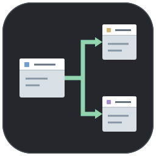

# Project Flow Explorer



**AI 코딩 도구(Codex)를 활용한 바이브코딩으로 제작한 VS Code 확장 프로그램입니다.** 화면 구성과 기능 요구사항을 바탕으로 AI와 함께 구현·수정했습니다.

VS Code에서 프로젝트 파일과 디렉토리, JS/TS 참조 관계를 그래프로 탐색합니다.
Figma 시안의 어두운 캔버스와 파일 카드, 경로 표시, 라이브러리 토글을 바탕으로 만든 첫 버전입니다.

## 설치 및 실행

1. VS Code에서 `Ctrl+Shift+P` (macOS `Cmd+Shift+P`) → `Extensions: Install from VSIX...`.
2. [GitHub Releases](https://github.com/kkt9102/project-flow/releases/latest)에서 받은 `project-flow-explorer-0.0.1.vsix` 선택.
3. 분석할 프로젝트 폴더를 열기.
4. 명령 팔레트 → `Project Flow: 프로젝트 구조도 열기`.

탐색기 파일·폴더 우클릭 메뉴에서도 열 수 있습니다. 설치를 위해 Marketplace 업로드는 필요하지 않습니다.

## 사용법

하단에 현재 구조도의 파일 수와 디렉토리 수를 표시합니다. 외부 패키지는 별도로 집계합니다. 폴더 이동 및 내부 연결·라이브러리 토글 변경 시 갱신되며, 화면 밖으로 이동한 카드도 포함한 현재 구조도 기준입니다. 검색은 강조만 변경하므로 개수는 유지합니다. 숨김·제외된 파일이나 폴더 내부에서 아직 표시하지 않은 파일까지 합산한 전체 프로젝트 개수는 아닙니다.

| 동작 | 결과 |
|---|---|
| 파일 더블클릭 / Enter | 옆 편집기에 파일 열기 |
| 폴더 더블클릭 / Enter | 해당 폴더 내부 구조도로 이동 |
| 상단 경로 클릭 | 상위 디렉토리로 이동 |
| 카드 클릭 | 연결된 파일과 참조선 강조 |
| 화살표 클릭 / 키보드 Enter | 연결된 함수·변수·타입 목록 표시 |
| 카드 드래그 | 카드 위치 변경 |
| 빈 공간 드래그 | 캔버스 이동 |
| 휠 / + / − | 확대·축소 |
| 화면 맞춤 | 전체 카드가 보이도록 맞춤 |
| 파일 검색 | 이름이 일치하는 카드 강조 |
| 폴더 내부 연결 ON/OFF | 내부 파일 직접 연결 / 폴더 단위 집계 전환 |
| 라이브러리 ON | node_modules 폴더 및 외부 패키지 참조 노드 표시 |

녹색 화살표는 참조하는 파일 → 참조되는 파일 방향입니다.
노란 점선은 폴더에 포함된 파일, 보라색 점선은 외부 패키지 참조입니다. 기본 ON인 폴더 내부 연결 모드에서는 내부 소스와 참조 대상 파일을 개별 표시합니다. 폴더 선택 시 내부 파일들의 참조도 강조합니다. 내부 파일의 더블클릭 열기도 지원합니다. 토글을 끄면 폴더 단위로 집계합니다.
예: `App.tsx → components/Button.tsx`와 `components ⋯→ components/Button.tsx`를 함께 표시합니다. 중첩 경로는 카드에 표시합니다. 토글 OFF 시 `App.tsx → components`로 집계합니다.
패키지 노드는 참조 이름을 표시하며 클릭해 소스를 열지는 않습니다. 패키지 내부는 `node_modules` 폴더로 직접 이동해 탐색합니다.

## 박스와 연결 상세

- 피그마 시안처럼 흰색 제목줄과 회색 본문, 작은 사각 모서리로 표시합니다.
- 초기 배치 간격은 가로 400px, 세로 250px입니다. 190×110px 박스 사이에 가로 210px, 세로 140px 여백을 둡니다.
- 처음에는 100% 배율로 표시합니다. 전체를 보려면 화면 맞춤을 누르세요.
- 화살표는 직각 꺾은선으로 표시합니다. 같은 열에서 중간 박스를 통과하는 긴 연결은 옆으로 우회합니다. 복잡한 그래프의 모든 교차를 제거하는 배치는 아닙니다.
- 화살표를 누르면 오른쪽에 import/export에 적힌 함수·변수·클래스·타입 이름과 별칭, 출처 파일·줄 번호를 표시합니다. X 또는 Esc로 닫습니다.
- 직접 분석한 대상 파일의 export 선언으로 종류를 구분합니다. 재수출을 거친 이름, CommonJS export 또는 외부 라이브러리처럼 종류를 확인하지 못한 이름은 심볼로 표시합니다.
- default import, named import, namespace import, type-only import, 재수출, require 구조 분해, 문자열 동적 import를 지원합니다. 모듈 전체를 가져오는 경우는 모듈 전체로 표시합니다.
- 폴더 포함 관계 화살표는 포함 안내를 표시합니다. 폴더 집계 모드에서도 출처 파일별 이름 목록을 유지합니다.
- 목록은 연결당 최대 200개입니다. 실제 실행 흐름, 호출·사용 횟수, 네임스페이스 내부의 개별 멤버 사용은 분석하지 않습니다.

## 지원 범위와 한도

- JS, JSX, TS, TSX, MJS, CJS, MTS, CTS의 정적 import/export, 문자열 require(), 문자열 dynamic import().
- 가장 가까운 tsconfig.json/jsconfig.json의 compilerOptions와 paths 별칭 지원. `extends` 설정 상속, 다중 프로젝트 참조, 번들러 전용 별칭은 미지원.
- 상대 경로로 직접 지정한 CSS·이미지 참조도 표시. CSS 자체의 @import와 url() 분석은 미지원.
- 현재 디렉토리 밖으로 나가는 참조는 표시하지 않습니다. 상위 경로에서 탐색하세요.
- 폴더 내부 연결 ON에서는 동일 폴더 내부의 참조도 상위 화면에 표시합니다. OFF에서는 폴더에 묶어 생략합니다. 내부의 모든 일반 파일을 나열하지는 않으며, 소스 파일과 참조 대상 파일을 표시합니다.
- 파일 이름 검색은 현재 표시된 노드에 적용됩니다.
- 한 화면 기본 파일/폴더 400개, 패키지 포함 최대 500개. 탐색 항목 3,000개, 소스 크기 512KB 한도. 한도 도달 시 상태 표시.
- 라이브러리는 기본 OFF. ON에서도 node_modules 전체를 자동 분석하지 않고 명시적으로 폴더 진입 시 분석합니다.
- .git, .next, dist, build, coverage, .codex, 심볼릭 링크, .env 계열 및 인증서·키 파일은 제외합니다.
- 파일 내용은 로컬에서 분석하며 서버나 외부 API로 전송하지 않습니다.
- 실행 순서·함수 호출·API·DB 관계를 추론하는 도구는 아닙니다.
- 로컬 파일 워크스페이스 대상입니다. 가상 워크스페이스는 미지원입니다.

## 개발

아이콘 원본: `media/icon.svg` (피그마로 드래그해서 벡터 편집 가능). VS Code 확장 목록·Marketplace용 이미지는 `media/icon.png` (256×256)입니다. 명령 메뉴는 밝은/어두운 테마별 `media/command-light.svg`, `media/command-dark.svg`를 사용합니다. 직접 제작한 그래픽이며 프로젝트 MIT 라이선스에 포함됩니다.

```sh
npm ci
yarn lint
npm test
npm run package
```

VS Code에서 이 폴더를 열고 F5를 누르면 확장 개발 호스트가 실행됩니다.
SVG 파일·폴더·패키지 아이콘은 직접 작성했으며 프로젝트 MIT 라이선스로 배포합니다.

## 공개 배포

업로드 위치: [Visual Studio Marketplace 게시자 관리](https://marketplace.visualstudio.com/manage).

1. Microsoft 계정으로 로그인하고 게시자(Publisher)를 만듭니다.
2. 이 프로젝트의 `publisher`는 `kkt9102`입니다. 해당 Marketplace 게시자 계정에서 업로드합니다.
3. 최초 공개 버전은 `0.0.1`이며 저장소·이슈 주소는 `package.json`에 설정되어 있습니다.
4. `yarn lint`, `npm test`, `npm run package`를 실행해 VSIX를 다시 만듭니다.
5. 게시자 관리 → **New extension → Visual Studio Code** → 새 VSIX를 업로드합니다.
6. 다음 버전부터는 `package.json`의 `version`을 올리고 패키징한 뒤 **More Actions → Update**로 올립니다. 출력 파일명은 버전에 맞춰 자동 생성됩니다.

소스코드는 GitHub 저장소에서, 설치용 VSIX는 GitHub Releases에서 제공합니다. VS Code Marketplace 배포도 `0.0.1`부터 시작합니다. Marketplace 게시 여부와 GitHub 릴리즈 공개 여부는 별개입니다.

## 개발 및 검증 상태

JavaScript 문법 검사(`yarn lint`), 분석·심볼 추출·직각 경로 테스트(`npm test`), VSIX 패키징을 검증했습니다. 브라우저 기반 미리보기에서 연결선 클릭과 심볼 목록을 확인했으며, 실제 VS Code Extension Host에서의 통합 테스트는 아직 수행하지 않았습니다.

## 개인정보와 로컬 파일

분석은 로컬에서 실행합니다. 외부 서버로 소스코드를 전송하거나 사용 통계를 수집하는 코드는 포함하지 않습니다. `.env` 계열, 인증서·키 파일, `.codex`, 작업 기록 및 로컬 설치 파일은 저장소·배포 패키지에서 제외합니다. 버그 제보 시 개인 프로젝트의 경로나 소스코드가 포함된 화면은 직접 가려주세요.

공식 안내: https://code.visualstudio.com/api/working-with-extensions/publishing-extension
